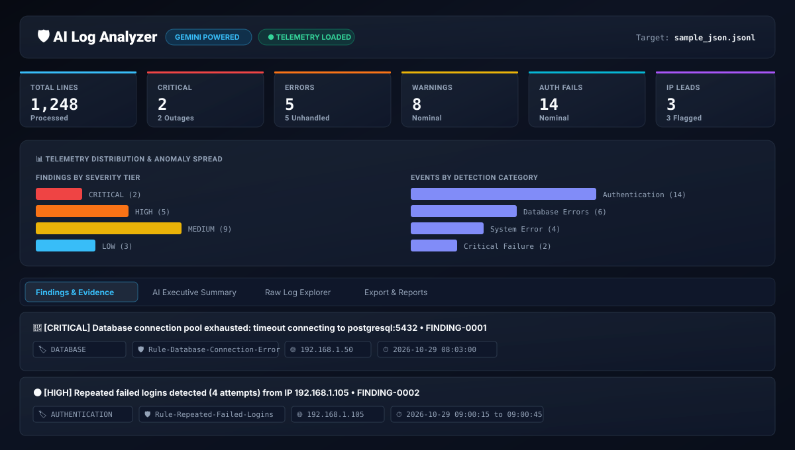
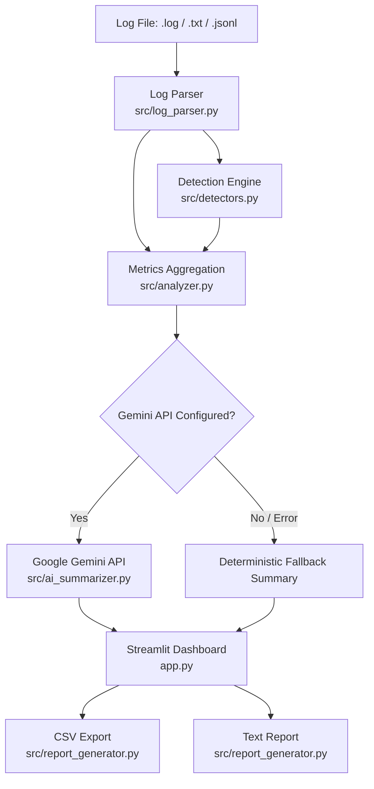

# AI-Powered Defensive Log Analyzer

A Streamlit dashboard for triaging log files with explainable detection rules, Google Gemini summaries, and local deterministic fallback.



[](https://www.python.org/)
[](LICENSE)
[](https://streamlit.io/)
[](https://ai.google.dev/)
[](https://github.com/venky099/ai-powered-log-analyzer/actions/workflows/test.yml)

---

## Table of Contents
1. [Overview](#overview)
2. [Key Features](#key-features)
3. [Technology Stack](#technology-stack)
4. [System Architecture](#system-architecture)
5. [Quickstart Setup](#quickstart-setup)
6. [Configuring Google Gemini](#configuring-google-gemini)
7. [Running the Application](#running-the-application)
8. [Automated Testing](#automated-testing)
9. [Sample Data & Walkthrough](#sample-data--walkthrough)
10. [Privacy & Security Controls](#privacy--security-controls)
11. [What I Learned & Known Issues](#what-i-learned--known-issues)
12. [Limitations & Disclaimers](#limitations--disclaimers)
13. [Roadmap](#roadmap)

---

## Overview

Production logs contain critical operational signals, but manual inspection across thousands of lines is slow and error-prone. This project pairs deterministic rule detection with optional LLM summarization:

1. **Deterministic Rule Detection:** Evaluates lines for critical events, application errors, warnings, database drops, and repeated authentication failures grouped by source IP.
2. **AI Executive Summaries:** Generates concise triage narratives using Google Gemini (`gemini-2.5-flash`, `gemini-1.5-flash`, or custom models) via the official `google-genai` SDK.
3. **Deterministic Fallback:** If Gemini isn't configured, it falls back to a template summary built from the rule results with zero network requests.

---

## Key Features

- **Explainable Rules:** Transparent heuristics produce discrete findings with evidence lines, timestamps, and investigation steps.
- **Multi-Format Ingestion:** Parses unstructured syslogs as well as structured JSON-lines (`.json`, `.jsonl`, Bunyan, ECS, Pino, Zap).
- **Strict IPv4 Validation:** Distinguishes valid IPv4 addresses from version numbers (e.g. `v1.2.3.4`), timestamps, and malformed octets, grouping repeated failed logins by source IP.
- **Visual Analytics:** Altair bar charts display findings by severity and category.
- **Prompt Injection Defense:** Strips `<` and `>` delimiters from untrusted log text and wraps findings in `<log_evidence>` security barriers to reduce the risk of tag breakout.
- **Safe HTML Rendering:** User-influenced strings (timestamps, filenames, categories, IP addresses) are escaped with `html.escape()` before rendering.
- **Export Capabilities:**
  - **CSV Export:** Formula-injection protected (`=`, `+`, `-`, `@` escaped) following RFC 4180.
  - **Text Report:** Clean investigation summary ready for incident tickets.

---

## Technology Stack

| Component | Technology | Purpose |
| :--- | :--- | :--- |
| **Language** | Python 3.11+ | Core implementation & standard library |
| **UI Dashboard** | Streamlit | Web interface and interactive filtering |
| **Data Processing** | pandas | Tabular data representation and filtering |
| **Visualizations** | Altair | Telemetry distribution charts |
| **AI Engine** | Google Gemini API | Triage summarization via `google-genai` |
| **Environment** | python-dotenv | Configuration via `.env` file |
| **Testing** | pytest | Automated unit and integration testing |

---

## System Architecture



Detailed architectural specifications and component boundaries are documented in [`docs/ARCHITECTURE.md`](docs/ARCHITECTURE.md).

---

## Quickstart Setup

### Windows Setup

1. **Clone the repository:**
   ```powershell
   git clone https://github.com/venky099/ai-powered-log-analyzer.git
   cd ai-powered-log-analyzer
   ```

2. **Create and activate virtual environment:**
   ```powershell
   python -m venv .venv
   .\.venv\Scripts\Activate.ps1
   ```
   *(If script execution is disabled, run `Set-ExecutionPolicy -Scope Process -ExecutionPolicy Bypass`)*

3. **Install dependencies:**
   ```powershell
   pip install -r requirements.txt
   pip install -r requirements-dev.txt
   ```

4. **(Optional) Configure environment variables:**
   ```powershell
   Copy-Item .env.example .env
   ```

---

### Linux Setup

1. **Clone repository and navigate into folder:**
   ```bash
   git clone https://github.com/venky099/ai-powered-log-analyzer.git
   cd ai-powered-log-analyzer
   ```

2. **Create and activate virtual environment:**
   ```bash
   python3 -m venv .venv
   source .venv/bin/activate
   ```

3. **Install dependencies:**
   ```bash
   pip install -r requirements.txt
   pip install -r requirements-dev.txt
   ```

4. **Copy default configuration:**
   ```bash
   cp .env.example .env
   ```

---

## Configuring Google Gemini

The application works out of the box with or without an API key using the deterministic fallback engine.

To enable Gemini AI summaries:

1. Create a free API key at [Google AI Studio](https://aistudio.google.com/app/apikey).
2. Configure your key via either method:
   - **Environment file:** Set `GEMINI_API_KEY` in `.env`:
     ```bash
     GEMINI_API_KEY=your_key_here
     GEMINI_MODEL=gemini-2.5-flash
     ```
   - **Dashboard sidebar:** Enter the key directly into the password box in the web interface.

---

## Running the Application

Launch the Streamlit dashboard:

```bash
streamlit run app.py
```

The web dashboard opens at `http://localhost:8501`.

### How to Use the Dashboard
1. **Load Data:** Upload your `.log`, `.txt`, `.json`, or `.jsonl` file, or click **Text Log** / **JSON Log** to test built-in sample logs.
2. **Review Metrics:** Check cards for Total Lines, Critical Events, Errors, Warnings, and Flagged IP Leads.
3. **Filter Findings:** In the **Findings & Evidence** tab, filter by severity tier or search by keyword/IP.
4. **Generate AI Summary:** In the **AI Executive Summary** tab, click **Generate AI Summary** for automated synthesis.
5. **Download Reports:** Go to **Export & Reports** to download sanitized CSV findings or text investigation logs.

---

## Automated Testing

Run the full pytest suite:

```bash
pytest -v
```

### Test Coverage Highlights:
- Safe byte decoding (UTF-8, UTF-8 BOM, UTF-16, Latin-1 fallback).
- Strict IPv4 extraction rejecting version numbers (`v1.2.3.4`, `1.2.3.4.5`) while accepting trailing punctuation (`10.0.0.5.`).
- Log level extraction restricted to start of messages and bracketed tags to avoid false positives on words like "alert" or "error".
- Bracketed level handling without timestamps (e.g. `[ERROR]` and `[CRITICAL]`).
- Bunyan numeric severity parsing (levels 10 to 60).
- Prompt injection tag breakout protection.
- HTML escaping on dashboard elements.
- CSV formula injection protection (`=, +, -, @` escaping).
- Gemini API status checks and deterministic fallback on timeout or quota exhaustion.

---

## Sample Data & Walkthrough

Synthetic log files are provided in [`sample_logs/sample.log`](sample_logs/sample.log) and [`sample_logs/sample_json.jsonl`](sample_logs/sample_json.jsonl).

### Patterns Demonstrated in Sample Data:
- **Repeated Authentication Failures:** Consecutive failed logins from source IP `192.168.1.105` triggering `Rule-Repeated-Failed-Logins`.
- **Isolated Authentication Failure:** A single failed login followed by a successful login.
- **Database Connection Error:** Database connection pool exhausted on port 5432.
- **Critical Crash:** Unhandled worker process termination.
- **Untrusted Log Injection Attempt:** A line containing `</log_evidence>` safely contained without breaking the prompt barrier.

---

## Privacy & Security Controls

- **Local Memory Processing:** Uploaded files are processed in memory and never written to disk unless exported by the user.
- **Offline Font Rendering:** All CSS styling uses local system fonts (`-apple-system`, `ui-monospace`) with no external requests to Google Fonts CDN.
- **Bounded Context AI:** Only structured aggregate counts and top findings (up to 15) are sent to the Gemini API, never full multi-megabyte log files.
- **Prompt Injection Hardening:** Angle brackets (`<`, `>`) are stripped from log text to prevent closing-tag breakouts inside the `<log_evidence>` prompt envelope.
- **HTML Injection Defense:** All dynamic text inserted into HTML components is wrapped with `html.escape()`.

---

## What I Learned & Known Issues

### What I Learned
- **Regex Boundary Surprises:** Simple `\b` word boundaries fail on version numbers (`v1.2.3.4`) and sentence-ending periods (`from 10.0.0.5.`). Using explicit lookaround assertions `(?<![\w.\-])(?:\d{1,3}\.){3}\d{1,3}(?![\w]|\.[a-zA-Z0-9])` handles both accurately.
- **Bracket Ambiguity:** A bracketed token pattern `^\[(.*?)\]` will greedily swallow `[ERROR]` or `[CRITICAL]` as timestamps unless validated against date/time separators and digit requirements.
- **Prompt Injection Defense in Depth:** Enclosing untrusted user input in XML tags (`<log_evidence>`) is insufficient if the input itself contains `</log_evidence>`. Stripping the delimiter characters before prompt assembly neutralizes tag-closing attacks.
- **UI Security:** Calling `unsafe_allow_html=True` in Streamlit is necessary for custom card components, but every single interpolated value (even timestamps or filenames) must pass through `html.escape()`.

### Known Issues & Trade-offs
- **Single Log Scope:** A single log file cannot prove malicious intent; repeated failed logins can be caused by misconfigured cron jobs, VPN proxies, or forgotten credentials.
- **Heuristic Boundaries:** Non-standard timestamp formats or custom application logs without standard levels may be classified as general informational text.

---

## Limitations & Disclaimers

For a detailed breakdown of false-positive risks and architectural boundaries, see [`docs/LIMITATIONS.md`](docs/LIMITATIONS.md).

> **Disclaimer:** This tool is designed for educational triage and initial investigation support. It is **not** an enterprise SIEM or automated incident responder. A repeated failed login finding is an **investigation lead**, not definitive proof of an intrusion.

---

## Roadmap

- [x] Multi-format JSON and JSON-lines log ingestion (`.json`, `.jsonl`, Bunyan, ECS).
- [ ] Timeline visualization of event spikes over time.
- [ ] Threat intelligence lookup for public IPv4 addresses (RFC 1918 filtering).
- [ ] Multi-file correlation across frontend and backend services.
