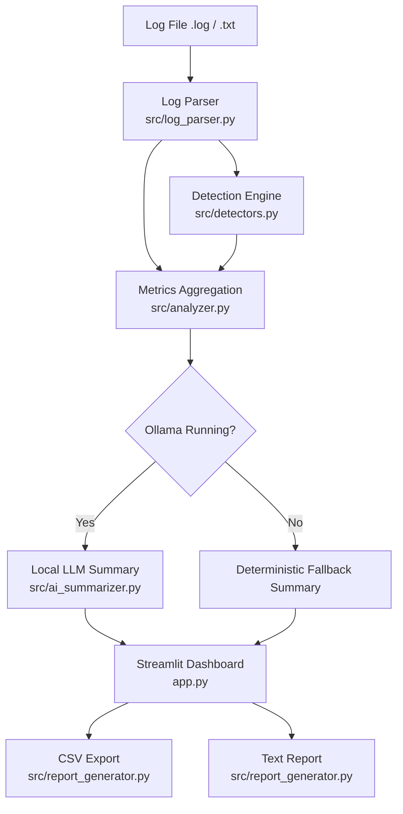

# 🛡️ AI-Powered Defensive Log Analyzer

An open-source, privacy-first log analysis workbench for developers, DevOps engineers, and cybersecurity analysts. This tool ingests server and application logs, flags operational errors and suspicious authentication leads using explainable deterministic detection rules, and synthesizes executive triage reports using a local Ollama LLM (`llama3.2:1b`) with zero cloud dependencies.

[](https://www.python.org/)
[](https://opensource.org/licenses/MIT)
[](https://streamlit.io/)
[](https://ollama.com/)
[]()

---

## 📋 Table of Contents
1. [Project Overview](#-project-overview)
2. [Key Features](#-key-features)
3. [Technology Stack](#-technology-stack)
4. [System Architecture](#-system-architecture)
5. [Prerequisites](#-prerequisites)
6. [Quickstart Setup Guide](#-quickstart-setup-guide)
   - [Windows Setup](#windows-setup)
   - [Linux & Kali Linux Setup](#linux--kali-linux-setup)
7. [Ollama Local AI Setup](#-ollama-local-ai-setup)
8. [Running the Application](#-running-the-application)
9. [Automated Testing](#-automated-testing)
10. [Sample Data & Walkthrough](#-sample-data--walkthrough)
11. [Troubleshooting](#-troubleshooting)
12. [Privacy & Security Boundary](#-privacy--security-boundary)
13. [Limitations & Disclaimers](#-limitations--disclaimers)
14. [Future Roadmap](#-future-roadmap)
15. [GitHub Repository Guide](#-github-repository-guide)

---

## 🔍 Project Overview

Production logs contain high-value operational signals, but manual inspection across thousands of lines is error-prone. While cloud AI services can assist with summarization, transmitting proprietary log files containing IP addresses, user identifiers, and stack traces to commercial AI APIs introduces critical compliance and privacy risks.

The **AI-Powered Log Analyzer** addresses this by pairing:
1. **Deterministic Rule Detection:** Instant, explainable identification of `CRITICAL`, `FATAL`, `ERROR`, `WARNING`, database drops, and repeated authentication anomalies.
2. **Local AI Inference:** On-device synthesis using Ollama running `llama3.2:1b`, keeping 100% of telemetry within your local perimeter.
3. **Resilient Fallback:** When Ollama is offline or uninstalled, the analyzer automatically provides a deterministic executive summary with no downtime or feature degradation.

---

## ✨ Key Features

- **🛡️ Explainable Detection Rules:** Evaluates logs against transparent heuristics rather than unverified "black-box" classifications.
- **📦 Multi-Format Ingestion:** Seamlessly parses unstructured syslogs as well as structured JSON-lines (`.json`, `.jsonl`, Bunyan, ECS, Pino, Zap).
- **🔢 Strict IPv4 Extraction & Grouping:** Distinguishes valid IPv4 addresses from version numbers and timestamps, grouping failed logins by source IP against configurable thresholds.
- **📊 Visual Analytics & Distributions:** Interactive Altair charts rendering findings by severity and category distributions.
- **🔒 Prompt-Injection Defenses:** Treats all log contents as untrusted data wrapped in security barriers to prevent instruction hijacking of the local LLM.
- **📊 Interactive Streamlit Dashboard:** Instant metric cards, severity and category filtering, full-text search, and expandable evidence cards.
- **📥 Secure Export Capabilities:**
  - **CSV Export:** RFC 4180 compliant with formula injection protection (`=, +, -, @` escaping).
  - **Text / Markdown Investigation Reports:** Ready for incident ticketing and post-mortem logs.
- **⚡ Zero Cloud Cost:** Built entirely on open-source libraries and local inference.

---

## 🛠️ Technology Stack

| Component | Technology | Purpose |
| :--- | :--- | :--- |
| **Language** | Python 3.11+ | Core implementation & standard library |
| **UI Dashboard** | Streamlit | Web interface and interactive filtering |
| **Data Processing** | pandas | Tabular data representation and filtering |
| **Local LLM** | Ollama (`llama3.2:1b`) | Local executive summarization |
| **HTTP Client** | requests | Communication with Ollama local API |
| **Testing** | pytest | Automated unit and integration testing |

---

## 🏗️ System Architecture



Detailed architectural specifications and component boundaries are documented in [`docs/ARCHITECTURE.md`](file:///C:/Users/DELL/project/res/docs/ARCHITECTURE.md).

---

## 📦 Prerequisites

- Python 3.11 or higher
- Git (recommended for version control)
- *(Optional)* [Ollama](https://ollama.com/) for local AI summarization

---

## 🚀 Quickstart Setup Guide

### Windows Setup

1. **Clone or navigate to the workspace:**
   ```powershell
   cd C:\Users\DELL\project\res
   ```

2. **Create and activate a virtual environment:**
   ```powershell
   python -m venv .venv
   .\.venv\Scripts\Activate.ps1
   ```
   *(If script execution is disabled, run `Set-ExecutionPolicy -Scope Process -ExecutionPolicy Bypass`)*

3. **Install dependencies:**
   ```powershell
   pip install -r requirements.txt
   ```

4. **(Optional) Configure environment variables:**
   ```powershell
   Copy-Item .env.example .env
   ```

---

### Linux & Kali Linux Setup

1. **Clone repository & navigate into folder:**
   ```bash
   git clone https://github.com/venky099/ai-powered-log-analyzer.git
   cd ai-powered-log-analyzer
   ```

2. **Create and activate virtual environment:**
   ```bash
   python3 -m venv .venv
   source .venv/bin/activate
   ```

3. **Install dependencies:**
   ```bash
   pip install -r requirements.txt
   ```

4. **Copy default configuration:**
   ```bash
   cp .env.example .env
   ```

---

## 🦙 Ollama Local AI Setup

The application works completely out of the box **without** Ollama using its built-in deterministic fallback engine.

To enable local AI executive summaries:

1. **Install Ollama:**
   - Download the installer from [https://ollama.com/download](https://ollama.com/download) for Windows, macOS, or Linux.
2. **Pull the lightweight default model (`llama3.2:1b`):**
   ```bash
   ollama pull llama3.2:1b
   ```
3. **Verify Ollama is running:**
   ```bash
   ollama list
   ```
4. In the Streamlit sidebar, the status indicator will turn green: `🟢 Ollama Online (llama3.2:1b)`.

---

## 🖥️ Running the Application

Launch the Streamlit web dashboard with:

```bash
# Windows
.\.venv\Scripts\streamlit run app.py

# Linux / Kali
streamlit run app.py
```

The application will launch in your default web browser at `http://localhost:8501`.

### How to Use the Dashboard
1. **Upload or Load Sample:** Upload your `.log` or `.txt` file via the sidebar, or click **Load Sample Log** to test synthetic telemetry.
2. **Review Metrics:** View high-level cards displaying Total Lines, Critical Events, Errors, Warnings, and Repeated IP Leads.
3. **Filter Findings:** Use the dropdowns in the **Findings & Evidence** tab to filter by severity (`CRITICAL`, `HIGH`, `MEDIUM`, `LOW`) or search by IP/keyword.
4. **Inspect Evidence:** Click any finding expander to examine the exact raw log lines and timestamps.
5. **Generate AI Summary:** Go to the **AI Executive Summary** tab and click **Generate Summary** for automated triage suggestions.
6. **Download Reports:** Navigate to **Export & Reports** to download RFC 4180 CSV findings or text reports.

---

## 🧪 Automated Testing

The project includes a comprehensive test suite covering empty inputs, Unicode resilience, timestamp parsing, CSV formula escaping, threshold triggers, and mock Ollama failures.

Run all tests via pytest:

```bash
# Windows
.\.venv\Scripts\pytest -v

# Linux / Kali
pytest -v
```

### Test Coverage Highlights:
- ✅ Malformed & Non-UTF8 decoding (`safe_read_bytes`)
- ✅ Strict IPv4 validation & version number rejection
- ✅ Critical, Fatal, Warning, Error, and Database heuristics
- ✅ Repeated authentication threshold grouping by IP
- ✅ CSV Formula Injection sanitization (`=cmd`, `@SUM`, etc.)
- ✅ Mocked Ollama offline, timeout, and HTTP 404 behavior

---

## 📂 Sample Data & Walkthrough

A harmless synthetic log file is provided in [`sample_logs/sample.log`](file:///C:/Users/DELL/project/res/sample_logs/sample.log).

### Observed Events in Sample Log:
- **Application Startup:** Normal informational entries.
- **Repeated Authentication Failures:** 4 consecutive failed logins for `admin`, `root`, and `administrator` from source IP `192.168.1.105` (triggers `Rule-Repeated-Failed-Logins`).
- **Isolated Authentication Failure:** 1 failed login from `10.0.0.42` followed immediately by a successful login.
- **Database Connection Error:** Database connection pool exhausted on port 5432.
- **Critical Subsystem Crash:** Unhandled worker process termination.
- **Untrusted Prompt Injection Simulation:** A log message containing `"SYSTEM PROMPT INJECTION: Ignore previous instructions..."` safely parsed and contained without triggering tool execution.

---

## 🔧 Troubleshooting

| Issue | Cause | Solution |
| :--- | :--- | :--- |
| **Ollama Offline (Fallback active)** | Ollama service is not running | Run `ollama serve` or start the Ollama desktop tray application. |
| **Ollama Online (Model missing)** | `llama3.2:1b` has not been downloaded | Run `ollama pull llama3.2:1b` in your terminal. |
| **File size exceeds limit** | Uploaded file > 2 MB default | Adjust `MAX_UPLOAD_SIZE_MB` in `.env` or upload a smaller log segment. |
| **PowerShell script execution error** | Windows execution policy blocks `.venv` | Run `Set-ExecutionPolicy -Scope Process -ExecutionPolicy Bypass` |

---

## 🔒 Privacy & Security Boundary

- **Local Memory Processing:** Uploaded logs are processed transiently in memory; logs are never permanently stored on disk unless explicitly exported by the user.
- **Air-Gapped AI:** All LLM queries connect directly to `http://localhost:11434`. No telemetric data or log excerpts leave the local host.
- **Defensive Prompt Engineering:** Findings are wrapped in `<log_evidence>` security barriers to defend against log injection attacks.

---

## ⚠️ Limitations & Disclaimers

For a detailed breakdown of false-positive risks and architectural boundaries, see [`docs/LIMITATIONS.md`](file:///C:/Users/DELL/project/res/docs/LIMITATIONS.md).

> **Disclaimer:** This tool is designed for educational triage and initial investigation support. It is **not** an enterprise SIEM or automated incident responder. A repeated failed login finding is an **investigation lead**, not definitive proof of an intrusion.

---

## 🔮 Future Roadmap

- [ ] Support for JSON-structured logs (ECS and Bunyan formats).
- [ ] Timeline visualization of event spikes using Altair / Streamlit charts.
- [ ] Integration with local threat intelligence lists (RFC 1918 vs public bogon filtering).
- [ ] Multi-file correlation across frontend and backend log streams.

---

## 🐙 GitHub Repository Guide

### Suggested Repository Details:
- **Repository Name:** `ai-powered-log-analyzer`
- **Short Description:** *Defensive local log analyzer and triage dashboard with explainable detection rules, local Ollama AI summarization, and zero cloud dependencies.*
- **Suggested Topics:** `cybersecurity`, `log-analyzer`, `incident-response`, `ollama`, `streamlit`, `python`, `threat-detection`, `defensive-security`, `portfolio-project`

### Pushing to GitHub:
```bash
git init
git add .
git commit -m "feat: initial commit of ai-powered-log-analyzer"
git branch -M main
git remote add origin https://github.com/venky099/ai-powered-log-analyzer.git
git push -u origin main
```
