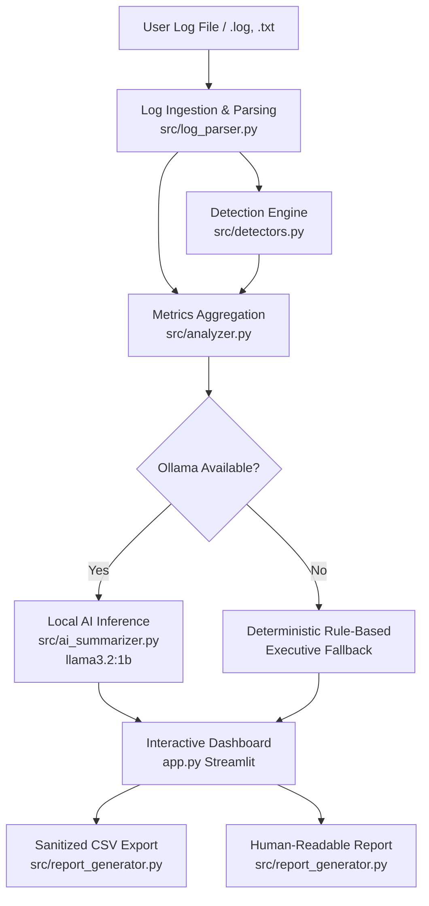

# System Architecture

## Overview

The **AI-Powered Log Analyzer** is a defensive, privacy-preserving log investigation workbench designed to assist systems engineers, security analysts, and developers in rapidly triaging application and server logs without sending sensitive data to third-party cloud APIs.

---

## Processing Pipeline

1. **Ingestion & Sanitization (`src/log_parser.py`)**
   - **Multi-Format Parsing:** Dual-mode parsing engine supporting unstructured standard syslogs and structured JSON-lines (`.json`, `.jsonl`, Bunyan, Winston, ECS, Zap).
   - **Encoding Resilience:** Safe binary decoding supporting UTF-8, UTF-8 BOM, UTF-16, and Latin-1 fallback (`errors="replace"`).
   - **Newline Normalization:** Standardizes CRLF and CR into LF.
   - **Strict IPv4 Validation:** Rejects version numbers (e.g. `v1.2.3.4`), timestamps, and malformed octets (`999.999.999.999`) using `ipaddress.IPv4Address`.
   - **Timestamp Normalization:** Parses ISO-8601, Syslog, bracketed, and common slash-formatted timestamps while preserving original line structure.
   - **Defensive Line Limits:** Enforces line length caps (default 4,096 chars) to prevent memory ballooning and regex denial-of-service.

2. **Deterministic Detection Engine (`src/detectors.py`)**
   - Rules run deterministically on parsed entries:
     - **Critical / Fatal Failures:** High-urgency operational outages.
     - **Repeated Failed Logins:** Aggregates authentication failures per source IP against a configurable threshold (default: 3). Identifies potential brute-force or credential stuffing leads.
     - **Isolated Authentication Failures:** Captures singular auth failures without grouping noise.
     - **Database & Storage Failures:** Identifies deadlocks, timeouts, and pool exhaustion.
     - **Warnings & General Errors:** Categorizes operational anomalies.
   - **Explainability:** Every finding includes category, severity, evidence lines, timestamps, rule name, recommended investigation steps, and explicit analytical limitations.

3. **Orchestration & Metric Aggregation (`src/analyzer.py`)**
   - Correlates line counts, unique source IPs, and severity breakdowns.
   - Provides multi-dimensional filtering (by severity, category, or free-text keywords).
   - Bundles verified evidence into structured contexts for AI summarization.

4. **Local AI Executive Summarization (`src/ai_summarizer.py`)**
   - **Prompt Injection Defense:** Encapsulates findings inside `<log_evidence>` tags with explicit defensive system prompts warning the model to treat all log entries as untrusted data.
   - **Bounded Context:** Supplies top findings and metric aggregates rather than dumping raw multi-megabyte log files into the model context.
   - **Offline Resilience:** If Ollama is offline or the model is not yet pulled, automatically generates a comprehensive deterministic executive summary with identical sections and zero service degradation.

5. **Reporting & Presentation (`src/report_generator.py` & `app.py`)**
   - **Streamlit Interface:** Responsive dashboard with metrics cards, filterable tables, and evidence expanders.
   - **CSV Export:** Formula injection protection (sanitizes `=, +, -, @` cell prefixes) compliant with RFC 4180.
   - **Text Investigation Report:** Formatted markdown/text report suitable for security tickets, triage logs, and compliance documentation.
